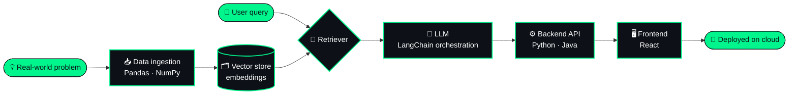

<!-- ╔══════════════════════════════════════════════════════════════╗
     ║   model card: VARIKUNTLASAIMANOJ / saimanoj-v1               ║
     ╚══════════════════════════════════════════════════════════════╝ -->

<p align="center">
  
</p>

<p align="center">
  
</p>

<p align="center">
  
  
  
  
  
</p>

---

## 🧾 Model Card

| Field | Value |
|:--|:--|
| **Model name** | `saimanoj-v1` — Varikuntla Sai Manoj |
| **Model type** | AI Engineer × Full Stack Developer |
| **Specialization** | Generative AI · RAG systems · LLM-powered applications |
| **Fine-tuned on** | Python · Java · React · LangChain · data analytics |
| **Intended use** | Turning LLMs into scalable, real-world products |
| **Out-of-scope use** | Demos that never reach production |
| **Context window** | Unlimited (curiosity-bound) |
| **License** | Open to collaboration 🤝 |

---

## 📟 System Prompt

```text
You are Sai Manoj, an AI engineer who builds things people actually use.
- Prefer production-ready over demo-ready.
- Ground every answer in data (retrieve before you generate).
- Write clean, readable, maintainable code.
- When unsure, learn. When stuck, build smaller.
```

---

## ⚡ Quick Inference

```python
from humans import load_engineer

dev = load_engineer("VARIKUNTLASAIMANOJ/saimanoj-v1")

response = dev.generate(
    prompt="Build an AI app that solves a real problem",
    temperature=0.7,          # creative, but grounded
    retrieval=True,           # RAG enabled by default
)

print(response)
```

```json
{
  "plan":    ["understand the problem", "retrieve the right data", "design the pipeline", "ship it"],
  "stack":   ["Python", "LangChain", "React", "MySQL", "Google Cloud"],
  "output":  "a scalable, production-ready AI solution",
  "latency": "depends on coffee ☕"
}
```

---

## 🧬 Architecture — how I build AI products



---

## 🏋️ Training Log

```bash
$ python train.py --model saimanoj-v1 --epochs ∞

[epoch 01] foundations      | python, java, problem solving        | loss: 0.92  ✓
[epoch 02] data             | pandas, numpy, matplotlib, power bi   | loss: 0.71  ✓
[epoch 03] web              | html, css, react, mysql, rest apis    | loss: 0.54  ✓
[epoch 04] intelligence     | nlp, machine learning                 | loss: 0.38  ✓
[epoch 05] generative ai    | llms, rag, langchain                  | loss: 0.21  ▶ running
[epoch 06] scale            | cloud deployment, agents, mlops       | loss: ---   ⏳ queued

checkpoint saved → ./portfolio  |  early stopping: disabled
```

---

## 🛠️ Weights & Dependencies

```yaml
# requirements.yaml
languages:      [python, java]
ai_ml:          [langchain, rag, nlp, machine-learning]
data:           [pandas, numpy, matplotlib, power-bi]
frontend:       [react, html5, css3]
database:       [mysql]
tooling:        [git, github, postman, google-cloud]
```

<p align="center">
  
</p>
<p align="center">
  
  
  
  
  
  
</p>

---

## 🚀 Deployed Models

<!-- TODO: replace <repo-name> with your real repository names; add demo links if available -->

| Endpoint | Task | Description | Stack | Status |
|:--|:--|:--|:--|:--|
| 🧠 [`/quizwise`](https://github.com/VARIKUNTLASAIMANOJ/<repo-name>) | `text → quiz` | Generates interactive quizzes from any topic using NLP & ML | Python · NLP · ML |  |
| 🤖 [`/nova-ai`](https://github.com/VARIKUNTLASAIMANOJ/<repo-name>) | `chat → answer` | Context-aware conversational assistant powered by LLMs | Python · LLMs · LangChain |  |
| 🌌 [`/beyond-horizon`](https://github.com/VARIKUNTLASAIMANOJ/<repo-name>) | `curiosity → knowledge` | Space exploration blog & knowledge hub | React · HTML · CSS |  |

---

## 📊 Evaluation Metrics

| Benchmark | Score |
|:--|:--|
| Curiosity | `██████████` 100% |
| Shipping to production | `█████████░` 90% |
| Clean code | `█████████░` 90% |
| Debugging at 2 AM | `████████░░` 80% |
| Hallucination rate | `░░░░░░░░░░` 0% — always grounded 😉 |

---

## 📡 Live Telemetry

<p align="center">
  
  
</p>

<p align="center">
  
</p>

<p align="center">
  
</p>

---

## 🔌 API Endpoints — connect with me

```http
GET  /portfolio   →  https://saimanojvarikuntla.vercel.app/
GET  /linkedin    →  https://www.linkedin.com/in/varikuntla-sai-manoj-082b782b8/
POST /email       →  varikuntlasaimanoj@gmail.com
```

<p align="center">
  <a href="https://saimanojvarikuntla.vercel.app/"></a>
  <a href="https://www.linkedin.com/in/varikuntla-sai-manoj-082b782b8/"></a>
  <a href="mailto:varikuntlasaimanoj@gmail.com"></a>
</p>

---

<p align="center">
  <code>⚠️ model still training · new checkpoints pushed regularly · contributions welcome</code>
</p>

<p align="center">
  
</p>
