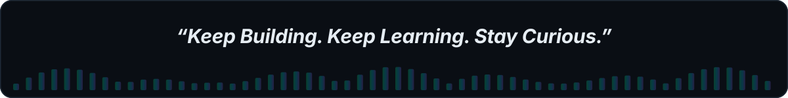

<!-- ───────────────────────────── HERO ───────────────────────────── -->
<p align="center">
  
</p>

<p align="center">
  
</p>

<p align="center">
  <a href="https://saimanojvarikuntla-portfolio.vercel.app/"></a>
  <a href="https://www.linkedin.com/in/varikuntla-sai-manoj-082b782b8/"></a>
  <a href="mailto:varikuntlasaimanoj@gmail.com"></a>
  
</p>

<br />

## `01` &nbsp;About Me

I’m an **AI Engineer & Full Stack Developer** passionate about building intelligent, scalable, and real-world impactful systems.

```python
class SaiManoj(AIEngineer, FullStackDev):
    focus    = ["GenAI", "RAG", "LLMs", "Agents"]
    applies  = ["Data Analytics", "ML"]
    learning = ["AI deployment", "Cloud"]
    ships    = "production-ready, not demos"
```

- 🚀 Developing **AI-Powered & Full Stack Applications**
- 🧠 Exploring **Generative AI, RAG, and LLM systems**
- 📊 Applying **Data Analytics & Machine Learning** to solve problems
- ☁️ Learning **AI deployment, cloud & scalability**
- 🎯 Focused on **production-ready solutions**, not demos

<br />

## `02` &nbsp;Known Technologies

<p align="center">
  
  
  
  
</p>

<p align="center"><sub><code>ALSO IN THE TOOLBOX</code></sub></p>

<p align="center">
  
  
  
  
  
  
  
  
  
</p>

<br />

## `03` &nbsp;Featured Projects

<p align="center">
  <a href="https://github.com/VARIKUNTLASAIMANOJ/Aperture"></a>
  <a href="https://github.com/VARIKUNTLASAIMANOJ/Tejoraj"></a>
  <a href="https://github.com/VARIKUNTLASAIMANOJ/ShopScribe"></a>
</p>

<br />

## `04` &nbsp;GitHub Analytics

<p align="center">
  
  
</p>

<p align="center">
  
</p>

<br />

## `05` &nbsp;Code Philosophy

> **“Write clean, scalable, and maintainable code.<br />
> Focus on real-world impact, readability, and continuous learning.”**

<br />

## `06` &nbsp;Let’s Connect

<p align="center">
  <a href="https://www.linkedin.com/in/varikuntla-sai-manoj-082b782b8/"></a>
  <a href="mailto:varikuntlasaimanoj@gmail.com"></a>
  <a href="https://saimanojvarikuntla-portfolio.vercel.app/"></a>
</p>

<br />

<p align="center">
  
</p>
